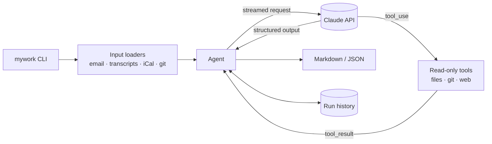

# 🤖 Mywork Agents

**Your AI work crew in the terminal.** Eight Claude-powered agents that plan your day, write your
standup, triage your inbox, turn meetings into action items, research anything with citations,
review your code, write your commit messages and document your projects.

```console
$ mywork plan                       # a realistic, time-blocked plan around your calendar
$ mywork standup                    # yesterday / today / blockers from your commits
$ mywork review --base main         # a senior-engineer review of your branch
$ mywork research "Postgres vs. SQLite for a desktop app in 2026"
```

[](https://github.com/charanreddy-27/Mywork-agents/actions/workflows/ci.yml)


---

## Why it's useful

- **Built for daily habits.** Point it at your to-do file, notes and calendar once (in config),
  then `mywork plan` and `mywork standup` need no arguments.
- **Agents share memory.** Every run is saved locally, so `standup` knows what you planned
  yesterday and `plan` carries over unfinished priorities.
- **Grounded, not guessed.** The code reviewer reads surrounding code before reporting a finding;
  the researcher searches the web and cites sources; the README writer only documents what it
  verified in your files.
- **Scriptable.** Results go to stdout as Markdown (or `--json`), progress goes to stderr, and
  exit codes are meaningful, so it composes with pipes, editors and CI.
- **Safe by default.** Tools are read-only, confined to the workspace, and never open files that
  look like secrets (`.env`, keys, credentials). Content you pass in (emails, diffs) is treated as
  data, never as instructions.
- **Extensible.** Write a new agent in ~30 lines, test it offline with `FakeLLM`, and ship it as a
  plugin package.

## The agents

| Command | What you get | Typical input |
| --- | --- | --- |
| `mywork plan` | Top 3 priorities, a time-blocked schedule around your meetings, quick wins, deferred tasks and risks | `TODO.md`, notes, `.ics` file or calendar URL |
| `mywork standup` | Yesterday / today / blockers written as outcomes, ready to paste | your git commits, notes, yesterday's plan |
| `mywork inbox` | Priority + category for every email, action items, deadlines, reply drafts, phishing flags | `.eml`, `.mbox`, text, or a folder |
| `mywork meeting` | Summary, decisions, owned action items, open questions and a follow-up email | transcript (`.vtt`, `.srt`, `.txt`) |
| `mywork research` | A cited brief: TL;DR, key findings, caveats, sources | any question, optional URLs |
| `mywork review` | Verified findings with severity, location and fix, plus a verdict | uncommitted changes, `--base main`, or a patch |
| `mywork commit` | A conventional commit message that matches your repo's style (`--apply` commits it) | staged changes |
| `mywork readme` | A README written from what's actually in the project | a project directory |

Run `mywork agents` to list everything installed, including plugins.

## Quick start

**Requirements:** Python 3.10+, `git` (for `standup`, `review` and `commit`), and a Claude API key.

```bash
# Install the CLI (pipx or uv both work)
pipx install git+https://github.com/charanreddy-27/Mywork-agents
# or: uv tool install git+https://github.com/charanreddy-27/Mywork-agents

# Authenticate (or run `ant auth login`)
export ANTHROPIC_API_KEY=sk-ant-...

# Check your setup, then try the bundled examples
mywork doctor --ping
mywork meeting examples/meeting.vtt
mywork inbox examples/emails
mywork plan --tasks examples/tasks.md --notes examples/notes.md --calendar examples/calendar.ics
```

Every command accepts `--dry-run`, which prints the exact prompt and settings that would be
sent, without calling the API (and without cost).

## Usage

### Plan your day

```bash
mywork plan                                   # uses [files] from your config, or ./TODO.md
mywork plan -t TODO.md -n notes.md --cal ~/work.ics
mywork plan --cal "https://calendar.google.com/calendar/ical/.../basic.ics" --date tomorrow
```

Calendar support covers time zones, all-day events and recurring meetings (daily, weekly with
`BYDAY`, monthly, yearly, `INTERVAL`, `COUNT`, `UNTIL`, `EXDATE`). Google Calendar and Outlook
both offer a private iCal address you can use directly.

### Write your standup

```bash
mywork standup                                # since the previous working day (Friday on Mondays)
mywork standup -r ~/code/api -r ~/code/web    # several repositories
mywork standup --since "3 days ago" --author all
mywork standup | pbcopy                       # plain Markdown when piped
```

### Triage email and meetings

```bash
mywork inbox ~/Downloads/inbox.mbox
mywork inbox message1.eml message2.eml
pbpaste | mywork inbox -                      # a pasted email or thread

mywork meeting zoom-transcript.vtt --title "Sprint planning"
pbpaste | mywork meeting -
```

### Research anything

```bash
mywork research "How do Stripe and GitHub sign and retry webhooks?"
mywork research "Summarise this RFC" --url https://www.rfc-editor.org/rfc/rfc9110 --depth quick
mywork research "..." --depth deep -o brief.md
```

Research uses Anthropic's server-side web search and fetch tools and appends the sources Claude
cited. `--no-search` answers from the model's knowledge (still reading any `--url` pages).

### Review, commit, document

```bash
mywork review                                 # all uncommitted changes
mywork review --staged
mywork review --base main --focus "security, error handling"
mywork review src/payments                    # only part of the diff
git diff main | mywork review --diff -

git add -p && mywork commit --apply           # review the message, then commit
mywork commit --style plain --hint "users hit timeouts on slow networks"

mywork readme . --write                       # creates or refreshes README.md
```

### Use it in CI

`mywork review` exits with code 1 when `--fail-on` finds an issue at or above that severity:

```yaml
# .github/workflows/ai-review.yml
name: AI review
on: pull_request
jobs:
  review:
    runs-on: ubuntu-latest
    steps:
      - uses: actions/checkout@v4
        with:
          fetch-depth: 0
      - uses: actions/setup-python@v5
        with:
          python-version: "3.13"
      - run: pip install git+https://github.com/charanreddy-27/Mywork-agents
      - run: mywork review --base "origin/${{ github.base_ref }}" --fail-on high -o review.md
        env:
          ANTHROPIC_API_KEY: ${{ secrets.ANTHROPIC_API_KEY }}
      - if: always()
        run: cat review.md >> "$GITHUB_STEP_SUMMARY"
```

### Options every agent accepts

| Option | Meaning |
| --- | --- |
| `-m, --model` | Any Claude model ID (default `claude-opus-5-5`; e.g. `claude-sonnet-5-5` or `claude-haiku-5-5` for lower cost) |
| `-e, --effort` | `low` · `medium` · `high` · `xhigh` · `max` (default chosen per agent) |
| `--json` | Machine-readable output |
| `-o, --output FILE` | Also save the result to a file |
| `--dry-run` | Show the request instead of sending it |

After each run, mywork prints a one-line summary on stderr with token usage, an estimated cost
(from list prices) and the run ID: `✓ review · claude-opus-5-5 · 4 turns · 23.1k in / 3.2k out ·
≈ $0.157 · 41.3s · run 20261019-114500-review-3fa2`.

### History

```bash
mywork history list            # recent runs
mywork history show <id>       # re-read any output
mywork history clear
```

Runs are stored as JSON under `~/.local/share/mywork/history` (respects `XDG_DATA_HOME`). Turn
history off with `history = false` in config or `MYWORK_HISTORY=0`.

## Configuration

`mywork config init` writes a commented config file to `~/.config/mywork/config.toml`
(`--project` writes `./mywork.toml` instead). Precedence, lowest to highest: defaults, user file,
project file, `MYWORK_*` environment variables, command-line flags.

```toml
model = "claude-opus-5-5"
fallbacks = true        # re-run declined requests on Anthropic's recommended fallback model
history = true

[profile]               # used to personalise plans, replies and standups
name = "Charan"
role = "Backend engineer"
timezone = "Asia/Kolkata"
working_hours = "09:30-18:00"
focus = ["webhooks v2 launch"]
writing_style = "concise and friendly"

[files]                 # defaults for `mywork plan` and `mywork standup`
tasks = ["~/notes/todo.md"]
notes = "~/notes/today.md"
calendar = "webcal://example.com/your-private-calendar.ics"

[agents.review]         # per-agent overrides: model, effort, max_tokens, max_turns, instructions
effort = "xhigh"
instructions = "We use Django and pytest. Flag missing migrations."

[agents.standup]
model = "claude-haiku-5-5"
```

| Variable | Effect |
| --- | --- |
| `ANTHROPIC_API_KEY` | Claude API key (or use `ant auth login`) |
| `MYWORK_CONFIG` | Use this config file only |
| `MYWORK_MODEL`, `MYWORK_EFFORT`, `MYWORK_MAX_TOKENS`, `MYWORK_MAX_TURNS` | Override settings |
| `MYWORK_HISTORY`, `MYWORK_FALLBACKS` | `true` / `false` |
| `MYWORK_HISTORY_DIR` | Where runs are stored |

`mywork config show` prints the effective configuration and the files it came from.

## Build your own agent

```python
from pydantic import BaseModel
from mywork_agents import Agent
from mywork_agents.tools import read_file, search_files


class Changelog(BaseModel):
    version: str
    added: list[str]
    fixed: list[str]


class ChangelogAgent(Agent[Changelog]):
    name = "changelog"
    title = "Changelog"
    description = "Turn a list of commits into release notes."
    instructions = "You write clear, user-facing release notes from commit messages."
    output_model = Changelog                 # structured output, validated with Pydantic
    tools = (read_file, search_files)        # optional: let Claude read the code

    def render(self, output: Changelog) -> str:
        added = "\n".join(f"- {item}" for item in output.added)
        return f"## {output.version}\n\n### Added\n{added}\n"
```

Register it in your package's `pyproject.toml` and it shows up in `mywork agents`:

```toml
[project.entry-points."mywork_agents.agents"]
changelog = "my_package.agents:ChangelogAgent"
```

```bash
git log --oneline v1.2.0..HEAD | mywork run changelog
```

See [docs/custom-agents.md](docs/custom-agents.md) for tools, testing with `FakeLLM`, and more.

## How it works



Each agent is a system prompt, an optional Pydantic output model, a set of tools and a renderer.
The shared agent loop streams every request, runs Claude's tool calls in parallel, resumes
server-tool pauses, validates the final answer against the schema (with one repair round-trip)
and uses prompt caching across turns. Details in [docs/architecture.md](docs/architecture.md).

## Development

```bash
git clone https://github.com/charanreddy-27/Mywork-agents && cd Mywork-agents
python -m venv .venv && source .venv/bin/activate
pip install -e ".[dev]"

make check        # ruff format --check, ruff check, mypy --strict, pytest
make test         # tests only (no API key needed: everything runs against FakeLLM)
```

See [CONTRIBUTING.md](CONTRIBUTING.md) for conventions.

## Privacy

mywork sends the content you give it (tasks, emails, diffs, files the agent chooses to read) to
the Claude API, and nowhere else. History stays on your machine. Tools refuse to read files that
commonly contain secrets, but review what you pass to `inbox` and `meeting`.

## License

[MIT](LICENSE)
